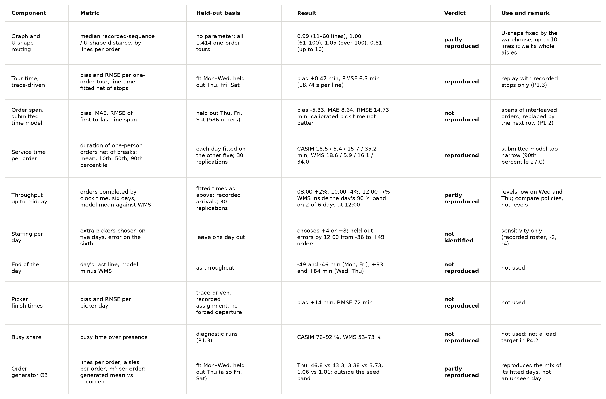
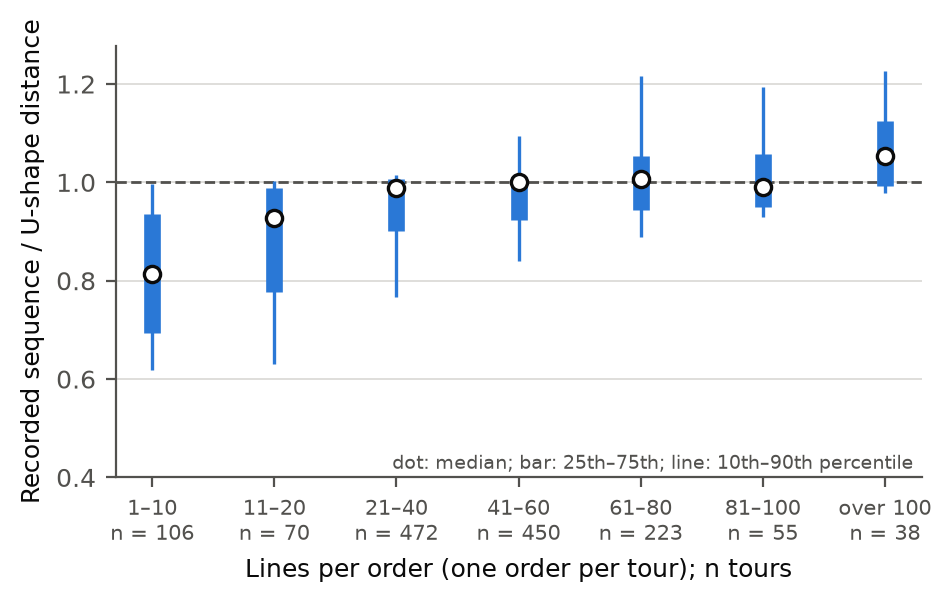
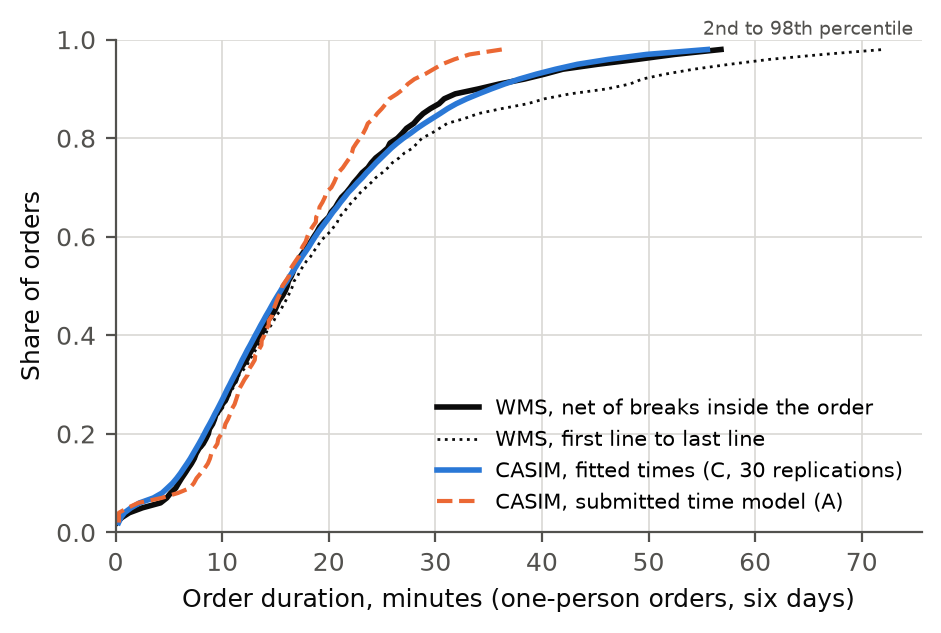
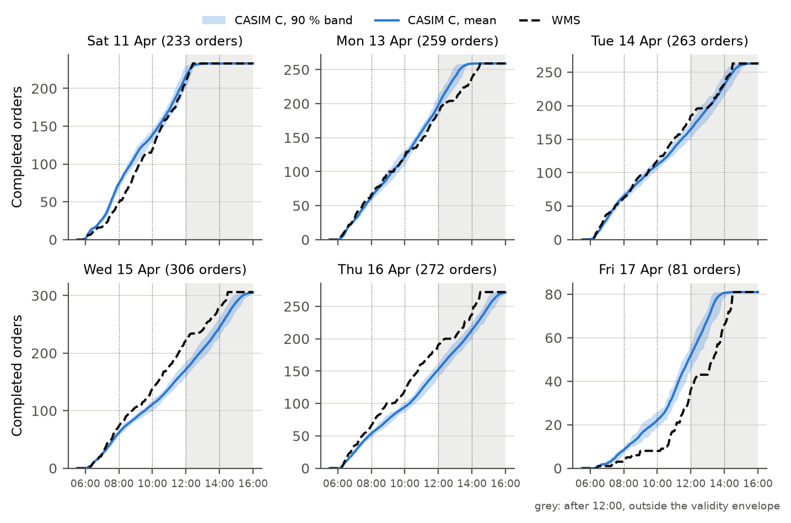

# Credibility profile of the IJPE model (P1.7)

Part 1 of the paper's positioning: what a practitioner can trust the model
for, component by component, on data the model was not fitted on. The
profile adds no fitting and no simulation runs. It collects the results of
P1.2 to P1.5 (`docs/ijpe/validation.md`) and closes with the validity
envelope that the experiments of P4 report in. The one new check is the
order generator G3 on held-out days.

Scripts (they write aggregates only):

- `scripts/ijpe/credibility.py` draws the figures in `docs/ijpe/figures/`
  and writes the tables to `scenarios/ijpe/outputs/credibility/` (ignored).
  It reads the trace-driven run `calibrated_recorded` and the capacity
  validation runs with FIFO as a pull (`outputs/capacity_fifo`, written by
  `scripts/ijpe/capacity_validation.py`).
- `scripts/ijpe/generator_holdout.py` runs the G3 check. It needs openpyxl
  for the article file: `uv run --with openpyxl python -m scripts.ijpe.generator_holdout`.

Every figure shows aggregates only: quantiles per class, quantile curves cut
at the 2nd and 98th percentile, and daily counts. No single order, line or
picker can be read from them.

## Profile

| Component | Metric | Held-out basis | Result | Verdict | Use |
|---|---|---|---|---|---|
| Graph and U-shape routing | median of recorded-sequence distance over U-shape distance, by lines per order | no parameter is fitted; all 1,414 one-order tours | 0.99 (11–60 lines), 1.00 (61–100), 1.05 (over 100), 0.81 (up to 10) | partly reproduced | U-shape is fixed by the warehouse. For orders of up to 10 lines it walks whole aisles that the pickers skip. |
| Tour time, trace-driven | bias and RMSE per one-order tour, line time fitted net of stops | fitted Mon–Wed, held out Thu, Fri, Sat | bias +0.47 min, RMSE 6.3 min (18.74 s per line) | reproduced | replay with the recorded stops only (P1.3) |
| Order span, submitted time model | bias, MAE and RMSE of the span from first to last line | held out Thu, Fri, Sat (586 orders) | bias −5.33 min, MAE 8.64, RMSE 14.73; the calibrated pick time does no better | not reproduced | The spans of interleaved orders cause this. Replaced by the next row (P1.2). |
| Service time per order | duration of one-person orders net of breaks: mean, 10th, 50th and 90th percentile | each day fitted on the other five; 30 replications | CASIM 18.5 / 5.4 / 15.7 / 35.2 min; WMS 18.6 / 5.9 / 16.1 / 34.0 | reproduced | The submitted model is too narrow: its 90th percentile is 27.0 min. |
| Throughput up to midday | orders completed by clock time, six days, model mean against the WMS | fitted times as above; recorded arrivals; 30 replications | 08:00 +2 %, 10:00 −4 %, 12:00 −7 %; the WMS lies inside the day's 90 % band on 2 of 6 days | partly reproduced | Levels are low on Wednesday and Thursday. Compare policies, not levels. |
| Staffing per day | extra pickers chosen on five days, error on the sixth | leave one day out | chooses +4 or +8; held-out errors by 12:00 from −36 to +49 orders | not identified | sensitivity only (recorded roster, −2, −4) |
| End of the day | day's last line, model minus WMS | as throughput | −49 and −46 min (Mon, Fri), +83 and +84 min (Wed, Thu) | not reproduced | not used |
| Picker finish times | bias and RMSE per picker-day | trace-driven, recorded assignment, no forced departure | bias +14 min, RMSE 72 min | not reproduced | not used |
| Busy share | busy time over presence | diagnostic runs (P1.3) | CASIM 76–92 %, WMS 53–73 % | not reproduced | not used; not a load target in P4.2 |
| Order generator G3 | lines, aisles and m³ per order, generated mean against recorded | fitted Mon–Wed, held out Thu (also Fri and Sat) | Thu: 46.8 vs 43.3 lines, 3.38 vs 3.73 aisles, 1.06 vs 1.01 m³; outside the seed band | partly reproduced | It reproduces the mix of the days it was fitted on, not an unseen day (below). |

The verdict scale: *reproduced* means the held-out error is small against
the quantity the paper uses. *Partly reproduced* means it holds for part of
the range or only as a total. *Not identified* means the data cannot tell
the value. *Not reproduced* means the model is wrong on that measure, and
no result of the paper rests on it.

## Graph and U-shape routing

CASIM walks each recorded order on its graph twice. Once in the recorded
line sequence: shortest paths from the depot through the lines in recorded
start order and back. Once as the U-shape route of the trace-driven run.
The ratio is the recorded distance over the U-shape distance.

| Lines per order | Tours | 10th | 25th | Median | 75th | 90th percentile |
|---|---:|---:|---:|---:|---:|---:|
| 1–10 | 106 | 0.62 | 0.69 | 0.81 | 0.94 | 1.00 |
| 11–60 | 992 | 0.80 | 0.90 | 0.99 | 1.01 | 1.05 |
| 61–100 | 278 | 0.90 | 0.95 | 1.00 | 1.06 | 1.22 |
| Over 100 | 38 | 0.98 | 0.99 | 1.05 | 1.12 | 1.23 |

U-shape matches the recorded walk for the 1,270 tours of 11 to 100 lines
(90 %). Tours of up to 10 lines are walked 19 % shorter than U-shape, which
traverses whole aisles. Tours over 100 lines are walked 5 % longer. U-shape
is the warehouse's rule, so the model keeps it. Small orders are slightly
slow in the model.

## Service time per order

This replaces the submitted Figure 8, which compared the model with the
same data it was calibrated on. The sample is the 1,040 one-person orders:
orders whose scan window overlaps no other order of their login. CASIM is
configuration C: line time with the order factor, tour setup and breaks,
fitted for each day on the other five days, with 30 replications pooled. A
break inside an order stretches its WMS duration, while CASIM takes breaks
between tours. The comparison is therefore net of the breaks the fit finds
inside the order (79 orders hold one).

| One-person orders, minutes | Mean | 10th | 50th | 90th percentile |
|---|---:|---:|---:|---:|
| WMS, first line to last | 21.1 | 6.0 | 16.6 | 46.1 |
| WMS, net of breaks | 18.6 | 5.9 | 16.1 | 34.0 |
| CASIM C, fitted times | 18.5 | 5.4 | 15.7 | 35.2 |
| CASIM A, submitted time model | 16.4 | 7.3 | 15.6 | 27.0 |

## Throughput by clock time

The figure shows cumulative completed orders per day: the WMS (last line
end of each order) against the mean and the 90 % band of the 30
replications of C. The model runs with recorded arrivals and no recorded
departure, so the recorded end of the day is not an input.

## Validity envelope

The envelope is stated by clock time, from the comparisons at 08:00,
10:00, 12:00 and 14:00 (C, six days, 30 replications).

| Clock | WMS orders done | CASIM mean (90 % band), six days | Error | WMS in six-day band | Days with WMS in day band | Mean absolute day error | Largest day error | Share of the WMS's orders done | Envelope |
|---|---:|---:|---:|---|---:|---:|---:|---:|---|
| 08:00 | 319 | 325 (314–334) | +2 % | yes | 2 of 6 | 10 | +25 (Sat) | 23 % | inside |
| 10:00 | 626 | 600 (578–618) | −4 % | no | 2 of 6 | 16 | −27 (Wed) | 44 % | inside, comparisons only |
| 12:00 | 1,031 | 956 (924–986) | −7 % | no | 2 of 6 | 24 | −50 (Wed) | 73 % | inside, comparisons only; edge of the envelope |
| 14:00 | 1,285 | 1,261 (1,240–1,279) | −2 % | no | 2 of 6 | 16 | −35 (Wed) | 91 % | outside |

- **Inside, up to 12:00.** The six-day level is right at 08:00 and 4 to
  7 % low at 10:00 and 12:00. The day pattern is not reproduced at any
  clock time: the WMS lies inside the day's replication band on 2 of 6
  days. The errors follow the days with interleaved orders (Wednesday and
  Thursday) and the unknown staffing, not the clock. Up to 12:00, therefore,
  the envelope covers *differences between policies* under common random
  numbers. It does not cover the absolute level of a day.
- **Outside, after 12:00.** The six-day total at 14:00 is close (−2 %),
  but only because days run out of work. By 14:00 the WMS has done 91 % of
  its orders, and Saturday is finished. Day errors stay up to 35 orders,
  and the end of the day is off by up to 84 minutes. Measures that depend
  on the afternoon or on the end of the day lie outside the envelope.
- **Never inside.** Measures at picker level (finish times, busy, idle
  and absent time per picker), busy share, and the level of staffing.

### Pre-picking caveat

The manuscript (Section 4.1) says that early delivery windows are picked the
day before. CASIM releases every order at 05:30 on its own day. The export
has no delivery or departure date, so it cannot show which volume of a day
was picked ahead. In the model, the 09:30 deadlines therefore face the
whole day's work from 05:30, and they may be tighter than in practice.
Absolute on-time rates and lateness of the 09:30 group are pessimistic in
that sense. The onset of a bottleneck for a request into the 10:00 slot may
come at a lower volume than on the floor. Comparisons between policies are
affected less, since every policy meets the same release. The same
assumption is stated for S4 and S2+S4 (plan, P2.1).

## The KPIs of P4 against the envelope

Every KPI planned for a scenario is tagged here (consistency check before P4
is written up). "Comparison" means it is reported only as a difference
between policies or against the baseline of the same seed, with common
random numbers, and marked as such. The deadlines are those of the
synthetic dispatch plan (09:30, 11:30, 13:30, 15:30;
`docs/ijpe/departure_fallback.md`). The tag follows the deadline, not the
scenario, so it holds if the scenario deadlines change.

| KPI (task) | Tag | Reported as |
|---|---|---|
| Orders completed by 08:00, 10:00, 12:00 (P2.3, P4.1, P4.2) | inside | comparison; levels with the profile's error stated |
| On-time rate, tardiness, maximum lateness of orders due 09:30 and 11:30, affected and unaffected (P2.3, P4.1, P4.4) | inside | comparison; 09:30 with the pre-picking caveat |
| Bottleneck onset in P4.2: the volume at which affected orders due by 11:30 miss their deadline, or unaffected orders due by 12:00 become late | inside | band over the replications, paired with the baseline of the same seed |
| Bottleneck onset in P4.2 for affected orders due 13:30 or 15:30 (today S1, from the 14:00 slot) | outside | comparison only, marked; or the onset read from the 12:00 measures |
| On-time rate, tardiness and maximum lateness of the 13:30 and 15:30 groups, and of the whole day (P2.3, P4.1) | outside | dropped, or comparison only and marked |
| Truck waiting per dispatch group (P4.7): 10:00 and 12:00 groups | inside | comparison |
| Truck waiting of the 14:00 and 16:00 groups, and cost summed over the day (P4.7) | outside | comparison only and marked; the cost per event is reported for the 10:00 and 12:00 groups and, separately, for the whole day |
| Whole-day effect of S4 on the receiving day (P4.4, S2+S4) | outside | comparison only and marked, with the pre-picking caveat |
| Open orders and orders carried at the end of the day, makespan per day (P2.3) | outside | dropped |
| Busy, idle and absent time per picker; busy share (P2.3, P4.2) | outside | dropped (busy share is not a load target) |
| Staffing axis of P4.2 and the priced staffing layer of P4.7 | staffing not identified | sensitivity: direction and order of magnitude, not a staffing recommendation |
| Sensitivity of walk speed, pick time, setup, margin (P4.5) | the tag of the KPI it reports | as that KPI |
| Pipeline selection, decision counts, computation time (P4.3, P4.5) | model property | not a prediction for the warehouse; no envelope applies |

## Order generator G3 on held-out days

G3 stays a claimed contribution: it is published with the data package (P5),
and S3 draws its new store order from it (P2.1). It is fitted on Monday to
Wednesday and generates Thursday, Friday and Saturday. The only input from
the held-out day is its number of store-days, the demand level a user sets.
The store-day profiles are resampled from the calibration days, and the
draw is held to their mean lines per store-day. There are 30 seeds per day.
The seed band holds only sampling variation. The range of the three
recorded calibration days is the day-to-day variation the fit has seen.

| Per order | Thu recorded | Thu generated (90 % band) | Fri recorded | Fri generated | Sat recorded | Sat generated | Mon–Wed recorded, range |
|---|---:|---:|---:|---:|---:|---:|---:|
| Lines, mean | 43.3 | 46.8 (45.1–48.6) | 34.9 | 46.7 | 41.9 | 47.0 | 39.2–51.2 |
| Lines, 10th / 50th / 90th percentile | 24 / 41 / 64 | 16 / 46 / 79 | 11 / 37 / 53 | 15 / 45 / 78 | 17 / 40 / 74 | 16 / 45 / 80 | 2–23 / 38–50 / 69–85 |
| Aisles, mean | 3.73 | 3.38 (3.27–3.47) | 2.84 | 3.34 | 3.62 | 3.39 | 3.08–3.68 |
| Share in at most 2 aisles | 0.54 | 0.64 | 0.78 | 0.64 | 0.57 | 0.63 | 0.57–0.72 |
| Share in 6 aisles or more | 0.39 | 0.34 | 0.21 | 0.33 | 0.40 | 0.34 | 0.25–0.39 |
| Volume, m³, mean | 1.01 | 1.06 (1.02–1.12) | 0.81 | 1.06 | 0.84 | 1.07 | 0.98–1.24 |
| Volume, m³, 90th percentile | 1.64 | 1.88 | 1.35 | 1.87 | 1.39 | 1.91 | 1.98–2.26 |

- In sample, G3 reproduces the days it was fitted on. Generating Monday to
  Wednesday from their own profiles gives a mean of 39.3, 48.9 and 51.1
  lines per order against 39.2, 48.7 and 51.2 recorded. On held-out days
  it gives the pooled mix of its calibration days.
- Held out, most measures lie outside the seed band. The recorded Thursday
  and Saturday lie inside the range of the calibration days in lines and
  volume per order. They lie outside it in the spread of order sizes and in
  aisle access: G3 makes too many orders of at most 2 aisles (0.64 against
  0.54 and 0.57). Friday, a short day of 81 orders, lies outside the range
  in every per-order measure. Saturday and Friday orders hold less volume
  (0.84 and 0.81 m³ against 0.98 to 1.24 on Monday to Wednesday): a weekday
  effect that a fit on three weekdays cannot see.
- Total volume for a given number of store-days is right on Thursday
  (265 m³ generated, inside the band, against 276 recorded), and 7 % high on
  Saturday.
- Verdict: partly reproduced. G3 generates a plausible weekday of the
  calibration mix, which is enough for the published generated week (fitted
  on all six days, each day from its own profiles) and for S3's single
  order conditioned on volume. It is not a forecast of a particular unseen
  day, and the paper should not claim that.
- Volume uses the canonical package volume: packages per line are
  GEWICHT_SOLL over the package weight of the article file, times the
  package volume. MENGE_IST counts single units, not packages. On the
  held-out days, quantity times package volume would overstate the volume
  15.8 times (median 9 units per package). G3 draws a quantity in units and
  multiplies it by the article's volume per unit, so it follows the
  package-based volume.
